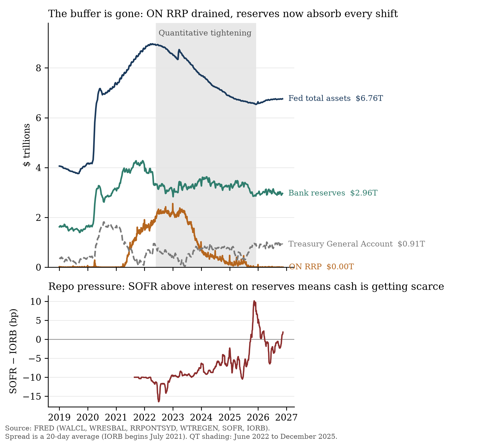

# What the End of Fed Balance Sheet Runoff Means for Repo Funding

*Porokmi Sambahamphe · November 2026 · Data: FRED, through November 2026*

## 1. What happened
The Fed’s total assets fell from $8.97 trillion in April 2022 to $6.76 trillion in the November 2026 FRED data. The FOMC announced on October 29, 2025, that it would end securities runoff effective December 1, 2025. Total assets bottomed in December and have edged higher since. Over this period, overnight reverse repo (ON RRP) balances fell from a peak of about $2.5 trillion in late 2022 to almost zero. Bank reserves declined from around $4.2 trillion in late 2021 but have been relatively stable over the past year, most recently at around $2.96 trillion.

What stood out to me was how much the repo spread moved even while aggregate reserves were relatively stable. SOFR had traded about 10 basis points below the interest rate on reserve balances (IORB) when cash was more abundant. In late 2025, the spread averaged about 10 basis points above IORB for several weeks and hit 32 basis points on October 31, a month-end. In the latest snapshot, the spread was around 2 basis points and the Treasury General Account (TGA) stood at about $910 billion.

## 2. Why it matters now
During quantitative tightening, a large part of the adjustment on the liability side of the Fed’s balance sheet came from lower ON RRP balances. Money market funds could shift cash out of the facility and into Treasury bills or private repo. This helped limit the decline in bank reserves as the Fed’s assets fell. With ON RRP balances close to zero, there is much less room for that adjustment now.

Take a corporate tax date. When firms pay taxes out of their bank accounts, the Treasury’s cash balance at the Fed rises and bank reserves fall, all else equal. As the Treasury spends that cash, reserves rise again. Those flows happen on different days, and the timing matters for dealers financing Treasury positions overnight. If a large TGA increase coincides with dealers having less room on their balance sheets, repo rates can rise for a few days even when aggregate reserves look stable.

## 3. What to watch
I’d track daily SOFR–IORB alongside changes in the TGA and the pace of Fed purchases. In the dates I checked, the spread reached 11 basis points around the September 2025 tax date and 10 basis points around the December tax date. It reached 22 basis points around year-end. By April 2026, the tax-date peak was down to 7 basis points. The June tax date and quarter-end saw peaks of 4 and 3 basis points, respectively, and by September those figures were −1 and 0 basis points.

That makes me want to check how large the TGA increases actually were in each window. If the Treasury took in less cash in 2026, smaller repo moves would be less surprising. I’d compare dates with similar TGA increases, account for Treasury settlements and quarter-ends, and see how quickly the spread came back down. I’d also check whether Fed purchases added enough reserves to offset the TGA build over those same windows.

## 4. A trade idea or view
The late-2025 data support my initial view, but the much smaller moves in 2026 make me less confident that tax dates or quarter-ends alone are enough to widen the spread. SOFR traded above IORB on only 33% of days over the past year, and the end of runoff and subsequent Fed purchases may help explain why the spikes faded. My view is conditional now. If the TGA rises sharply and Fed purchases add too few reserves to offset the drain, I’d expect a temporary widening in SOFR–IORB, especially if it happens near quarter-end.

---
**Sources:** FRED series WALCL, WRESBAL, RRPONTSYD, WTREGEN, SOFR, IORB; FOMC statement, October 29, 2025.

**Reproduce:** `pip install pandas matplotlib` then `python make_chart.py`. The script downloads the latest FRED data and redraws the chart and CSVs.
